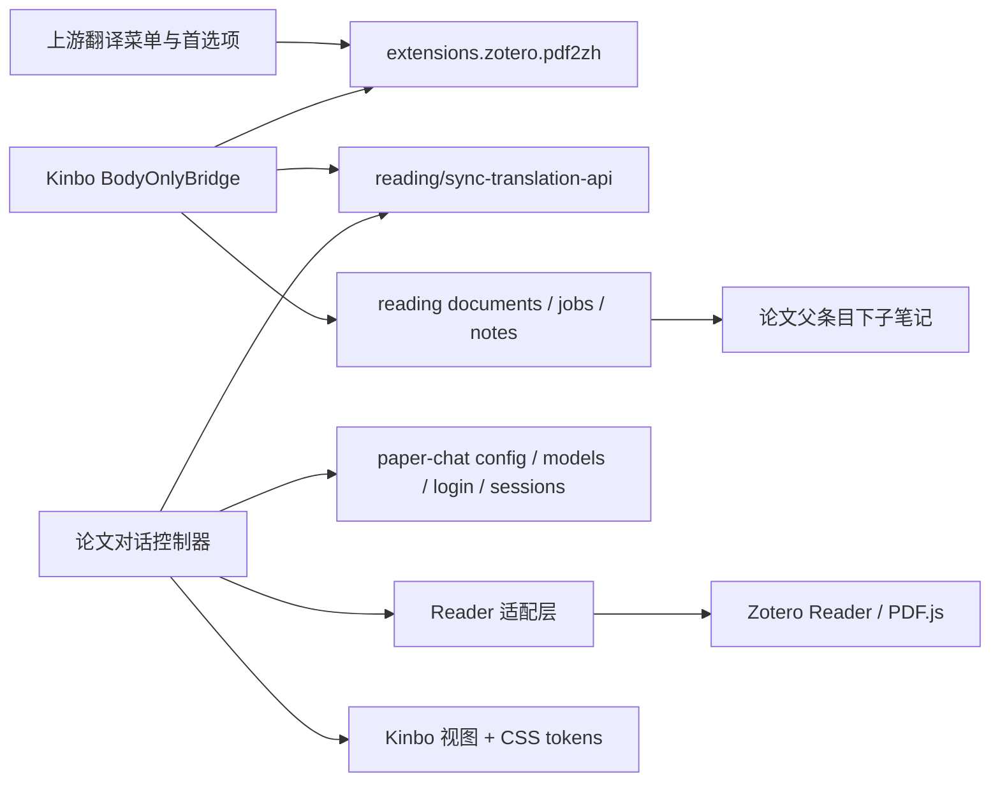

# Kinbo 插件 UI 架构审计与迁移计划

本文的只读审计与版本冻结约束记录第一阶段开发提交 `83819c3`。随后按正式发布授权，将 Kinbo 发行版本更新为 0.4.4、插件更新为 4.1.7.16，插件管理器采用 Kinbo 名称与图标；插件 ID、偏好命名空间和更新地址保持兼容。正式发行说明见 [release-notes.md](release-notes.md)。

审计日期：2026-11-03。先检查源码及固定的 Zotero PDF2zh 4.1.7 XPI，再实施本文第一阶段。范围为 Zotero 插件内界面，不改 `payload/index.html`、`payload/web/reading.js` 或后台协议。

## 现有界面归属

| 表面 | 拥有者与入口 | 依赖及处理 |
| --- | --- | --- |
| 插件生命周期、翻译/双语菜单与进度 | 上游 `bootstrap.js` → `content/scripts/pdf2zh.js` | 上游 `Zotero.pdf2zh.hooks`；继续保留 |
| Zotero 首选项、服务/引擎/语言/批量翻译选项 | 上游 `content/preferences.xhtml`、本地化 FTL | `extensions.zotero.pdf2zh.*`；本阶段不搬迁 |
| API 编辑器 | 上游 `content/llmApiEditor.xhtml`、`llmApiEditorEnhancements.js` | `llmApis`、`next_service` 与翻译共享配置；不能仅换壳后漏掉字段 |
| Kinbo 菜单、工具菜单、深度阅读进度 | `plugin/body_only_bridge.js` | 追加菜单、同步已有 API、轮询阅读任务 |
| PDF 对话工具栏、选文入口与侧栏 | `plugin/paper_chat.js` | 独立 DOM、全文输入、会话、模型、引用和原文临时高亮 |
| 子笔记内容 | `plugin/reading_note.js` | marked + DOMPurify，原生数学与归档身份保持不变 |
| 后台 Web 阅读页 | `payload/web/reading.js` 与 `payload/index.html` | 独立用户入口，已有设计及功能保持不变 |
| 后台源码更新状态 | `plugin/backend_update.js` | XPI 携带后端包，后台空闲检查/备份/回滚；不纳入视觉重构 |
| 插件管理器名称、图标与元数据 | XPI manifest / 上游图标 | 仍有上游/Body Only 身份，后续单独迁移 |

## Zotero 与 API 依赖

对话继续通过 `/api/paper-chat/config`、`/models?mode=codex`、`/login`、`/sessions`、`/sessions/:id`、`/messages`、`/cancel`、`/clear` 操作。发送字段仍为 `question / selection / mode / provider / model / effort / webSearch / customPrompt`。选文并非替代完整论文输入；创建会话仍遍历全部页面并拒绝静默截断。会话存储由 Python 后台负责，UI 不另建存储。

首选项仍在 `extensions.zotero.pdf2zh.paperChat.*`。服务地址继续读取 `new_serverip`；已有 API 复用 `llmApis` 和 `next_service`。视觉品牌独立并不意味着现在迁移这些身份。

## Reader 生命周期及边界

[Zotero 官方开发文档](https://www.zotero.org/support/dev/zotero_7_for_developers#reader) 提供 `registerEventListener`、`unregisterEventListener` 与 toolbar/selection popup 注入入口，并按插件 ID 清理注册。优先使用这些入口及 `Reader.open/getByTabID`、`reader.navigate`。

本次审计所用公开文档没有提供可等价替代任意对话分栏和全文字符坐标读取的独立稳定接口，因此保留现有内部访问并集中隔离，不能把以下字段宣称为稳定 API：`_iframe`、`_iframeWindow`、`_internalReader._primaryView`、`PDFViewerApplication`、`getPageData`、`Reader._readers`。Reader 适配层负责挂载位置、页面提取、跨 realm 克隆、引用高亮和已打开 Reader 的工具栏补挂；视觉组件不读取这些对象。

每个面板拥有可释放的事件、主题观察器、轮询和高亮定时器。关闭面板恢复 host/iframe 样式；停用清除所有面板、toolbar/popup 注入、Notifier 注册和延迟重试。异步返回不得在面板关闭后重新启动登录或会话轮询。窗口卸载、Reader iframe 卸载均触发关闭。关闭侧栏不会取消后台生成，重新打开通过已有会话恢复；停止按钮才请求取消。

## XPI 构建约束

`build_plugin.py` 先校验 `downloads.json` 的原版 SHA-256，读取整个上游包，再修补明确的 bootstrap hook，追加 Kinbo JS/CSS 与后端源码包，固定 ZIP 时间戳以便重复构建。上游资源和许可证继续保留。

- ID 仍为 `pdf2zh@guaguastandup.com`，不能与原版并装。
- 发布版本仍为 `4.1.7.15`，开发构建仍沿用既有 `4.1.7.16pre1`；本阶段不改版本常量。
- `update_url` 仍指向本仓库 main 的 `updates.json`，兼容范围保持不变。
- 新模块必须打进 XPI，先于控制器加载；CSS 在构建时作为字符串资源打包，避免运行时额外 fetch 与首次闪烁。
- 仅推送源码，不创建标签、Release 或更新清单；不会自动升级用户插件。

## 第一阶段文件计划

先交付 `DESIGN.md` 与 `docs/ui/paper-chat-preview.html`，再拆分：

| 文件 | 职责 |
| --- | --- |
| `plugin/paper_chat.js` | API、偏好、会话和界面事件编排 |
| `plugin/paper_chat_reader.js` | Reader 兼容访问、文本与引用定位、挂载恢复 |
| `plugin/paper_chat_view.js` | XHTML 结构、安全消息渲染、可访问状态，不调用后台 |
| `plugin/paper_chat.css` | 浅/深色 tokens、窄侧栏与控件状态 |
| `build_plugin.py`、bridge | 打包与按依赖顺序加载 |

成功条件：消息协议和完整页面输入不变；原测试继续通过；新增清理/异步竞争回归；原生 Zotero 隔离环境验证浅深色、开关、选文、历史、引用和窗口生命周期。跳过、模拟与真实验证分别报告。

## 后续独立任务

1. **Kinbo 设置壳**：整理上游首选项/API 编辑器字段与保存行为，分组为翻译、模型、阅读、存储、更新。先建立完整映射和回滚方案，再逐页替换；继续沿用旧 key。
2. **翻译交互迁移**：盘点批量、附件选择、双语布局、任务状态及失败恢复，先以适配器调用上游，不重写翻译引擎。
3. **品牌资源迁移**：插件管理器名称、图标已在 0.4.4 完成；后续继续审查本地化、帮助入口、原版残留文案及许可证归属。
4. **独立插件 ID / 命名空间**：另开兼容迁移项目，处理互斥安装、已有偏好/自动更新识别、旧版本回退、数据归属；不能只改 manifest。
5. **更稳定的 Reader 扩展点**：持续核实目标 Zotero 版本的官方侧栏接口，具备等价能力后再替换本适配层；添加多版本验证。

后台控制页的设计不在上述迁移范围内。

## 本轮追加的菜单收敛

用户于实现中补充：右键 Kinbo 子菜单的后半部只保留一个深度阅读/停止入口，并添加小图标。采用原 `/api/reading/jobs` 查询当前论文、当前 note client 的运行任务，单个菜单项在「深度阅读」「停止阅读」间切换；执行时重新查询，避免陈旧的菜单状态启动重复阅读。不新增后台协议、存储或模型调用。论文对话保留 Reader 工具栏与 Tools 入口，模型登录及后台更新入口迁到 Tools。新增六个单色线性 SVG，主菜单采用 Kinbo K/书页标记。前四项上游翻译入口保持行为不变。

原生多窗口测试发现：已关闭 Reader 窗口遗留的 Gecko dead wrapper 会让 toolbar 清理抛错并中断 bridge.stop，造成 Tools 残留。适配层现在单独释放已销毁的按钮引用，继续清理其他窗口、菜单、事件和定时器；模拟与真实停用测试均应覆盖这一边界。

真实截图还揭示 Zotero Windows chrome 的表单焦点样式会覆盖输入背景与边缘。XHTML 视图通过宿主样式明确提供的 `no-native` 属性退出这套外观，保留原生表单行为，由 Kinbo tokens 管理外观和焦点；原生测试核对实际输入背景，而非仅检查自定义属性值。

## 0.4.5 升级与后台连接修复

覆盖更新时，旧 Reader 清理异常可能跳过上游 shutdown，留下旧实例与菜单。bootstrap 现在在加载当前实例前清理旧实例，并以生命周期序号阻止停用后的异步注入；桥接层清理失败仍执行上游清理。窗口挂载只保留上游最后注册的当前菜单，删除已知历史入口，翻译命令仍来自当前上游实例。

新增 plugin/backend_connection.js 统一处理连接探测、已有本机服务唤醒、Mac 原后台文件夹选择和等待就绪；阅读、模型页与 Reader 重新连接复用这一入口，视觉组件不访问系统进程或文件。后台地址和设置命名空间保持原样，只增加按端口记录关联目录的插件偏好。

payload/utils/macos_autostart.py 为已安装后台生成用户级 LaunchAgent，使用原 Python 和原端口；不通过 shell 拼接启动命令，不强制重启已有服务。同目录配置不同端口、不同目录占用同一配置时拒绝覆盖。登录服务独立于 Zotero，保留正在运行的任务；插件停用仍解除自身界面、监听与等待计时器。

Mac 首次安装增加带固定下载哈希的 install-macos.command，源码 ZIP 明确保留其 Unix 执行权限。后续独立任务仍包括签名的原生 Mac 安装包、早期 0.3.x 后台的图形迁移、上游翻译设置页面迁移及插件身份迁移；本次不改插件 ID、自动更新地址或生产数据格式。
